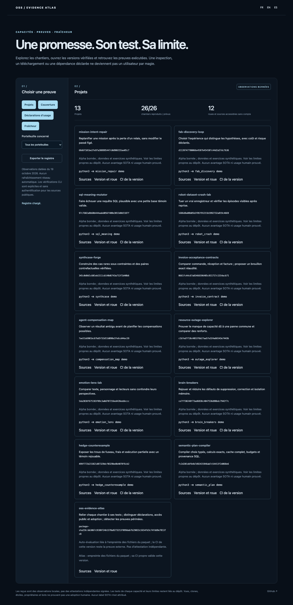

# OSS Evidence Atlas

[Français](README.md) · [Español](README.es.md)

**Connect every workstream to a deliverable and evidence; distinguish visibility, dependency declarations and adoption.**

Twelve new domain tools plus this evidence engine: **thirteen projects, twenty-six workstreams**, with distinct capabilities in shared repositories. The atlas retains versions, hashes, replay receipts and limits. Missing evidence remains visible; inspection alone never becomes an improvement.

## Try it

Python 3.11+; the gallery uses a recorded ledger, without keys or automatic network refresh.

```sh
git clone https://github.com/gbesse/oss-evidence-atlas
cd oss-evidence-atlas
python3 -m evidence_atlas serve --lang en
```

Open `http://127.0.0.1:8775/?lang=en`. Browse projects and releases, filter portfolios, simulate missing evidence, inspect a dependency declaration and change a synthetic freshness contract. Coverage and freshness are recalculated by the engine, not pre-drawn.

```sh
python3 -m evidence_atlas demo
```

`pip install .` also provides `evidence-atlas`. FR/EN/ES interface, errors, cards and documentation. Project names, identifiers and cited data remain unchanged.



## Three different evidence types

**Reproduced capability.** Every domain tool has a pinned Git commit, release CI links and three fresh receipts: demo with outcome assertions, unit suite without skips and browser workflow. All twelve demos, twelve suites and twelve browsers actually ran. The SQL demo must find a counterexample and exit 1; that expected status is not an arbitrarily ignored error. Per-capability tests remain in each repository; a smoke test does not establish all product properties.

Six cross-cutting workstreams concern this atlas: exhaustive coverage, executable gallery, dependency declarations, registered replay, freshness and anonymous access. Self-receipts bind to a SHA-256 fingerprint of package Python/JS/HTML/CSS files, **not a fabricated self-referential Git commit**. Changing those files invalidates bundled receipts; this release’s own CI supplements self-evaluation. Ledger and receipts are local observations, not independently signed attestations.

**Dependency declaration.** Collection reads `package.json` or PEP 621 dependencies in `pyproject.toml`, pins a commit first, retains path/hash/declared version, and distinguishes runtime/development/optional/peer scope, same GitHub owner and forks. Repeated observations are deduplicated. Version ranges are not resolved versions. Aliases, transitive dependencies, dynamic files and actual installation are not inferred.

The ledger records a real method trial: `carlaiau/read-with-jev` declares `@typesafe-ai/sdk` version `0.6.0` in a pinned public manifest. **This is not adoption of gbesse projects**, nor a count of people using that reader. A package’s npm `private` field does not make its GitHub repository private. No human adoption of the gbesse projects is established here. Different GitHub owners do not establish independent organizations; missing collected declarations do not establish nonuse.

```sh
pip install .
python3 -m evidence_atlas collect carlaiau/read-with-jev package.json npm @typesafe-ai/sdk typesafe-ai
```

**Freshness and access.** A freshness contract binds a source hash to a repository, commit and reproduction check. Changed source requires review even when the reproducer passes. Matching source + failure means failed reproduction. No receipt means no replay claim. Receipts for another revision fail validation. Published-source observations are real; demo toggles modify a synthetic example without claiming an upstream change.

```sh
python3 -m evidence_atlas freshness contract.json local-source receipt.json
python3 -m evidence_atlas audit card.json
```

Anonymous audit downloads the source file at its commit and the release wheel **without authentication**, comparing both expected SHA-256 hashes. All twelve domain wheels and sources were checked this way. The atlas wheel must be audited after publication and is excluded from those twelve bundled observations. Explicit network operations only, verified TLS, allowed GitHub hosts, timeout and size limits. No GitHub or Jev key required.

## Replay a tool

Export a ledger `cards` entry as `card.json`, prepare its checkout at the stated commit and install dependencies. Use a Python environment with that project’s requirements; browser replay also needs its npm packages and Chromium.

```sh
python3 -m evidence_atlas replay card.json /path/checkout demo
python3 -m evidence_atlas replay card.json /path/checkout unit
python3 -m evidence_atlas replay card.json /path/checkout browser
```

The engine verifies commit, remote and clean tree, then runs **only its code-registered command**. It executes no shell command supplied by a document, README or manifest. Provider credentials and secret environment variables are not forwarded. All twelve demos use synthetic data and control no real systems. Checks have a 120-second timeout; output is hashed, never interpreted as instructions.

## Sources, comparisons and limits

[GitHub already constructs dependency graphs from manifests](https://docs.github.com/en/code-security/concepts/supply-chain-security/supply-chain-security). This atlas supplies a small exportable pinned observation of a targeted package rather than replacing that graph. [GitHub separately reports views and visitors](https://docs.github.com/en/rest/metrics/traffic). Those counts, clones, stars, owner visits and bots do not establish human adoption and are not converted into users.

The focus is **workstream → release → test → limit**, with freshness checks and anonymous downloads. No exhaustive consumer discovery, verified human identity, operational qualification, SOTA benchmark or independent cryptographic attestation. Results are bounded exercises; read each repository’s limits. No social message, email or maintainer contact is sent.

## Verify

```sh
python3 -m unittest discover -s tests -v
npm ci
npx playwright install chromium
npm run test:browser
npm run format:check
```

Sixteen tests cover dependency scopes/normalization, duplicates, forks, absent evidence, pinned public collection, forbidden URLs, hashes, stale receipts, incomplete coverage and self-package invalidation. FR/EN/ES browser: gallery, twenty-six workstreams, removed evidence, limited declaration, changed source, failed reproduction, export, filters and mobile. Python 3.11/3.12 CI, package and installed wheel outside source. MIT; public alpha.
